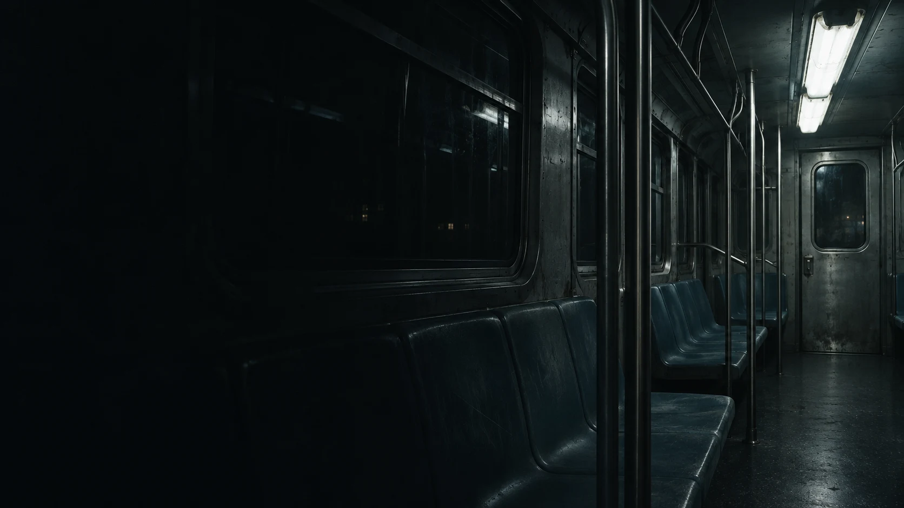
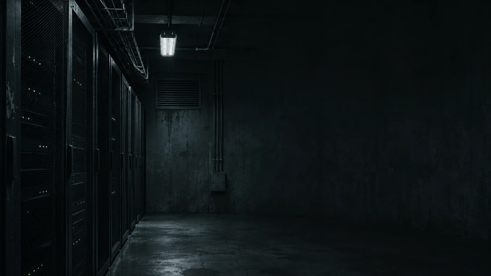
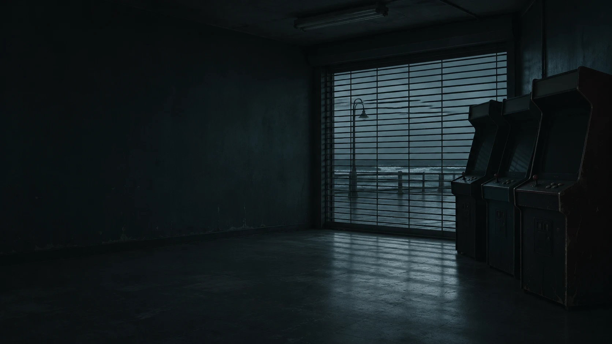
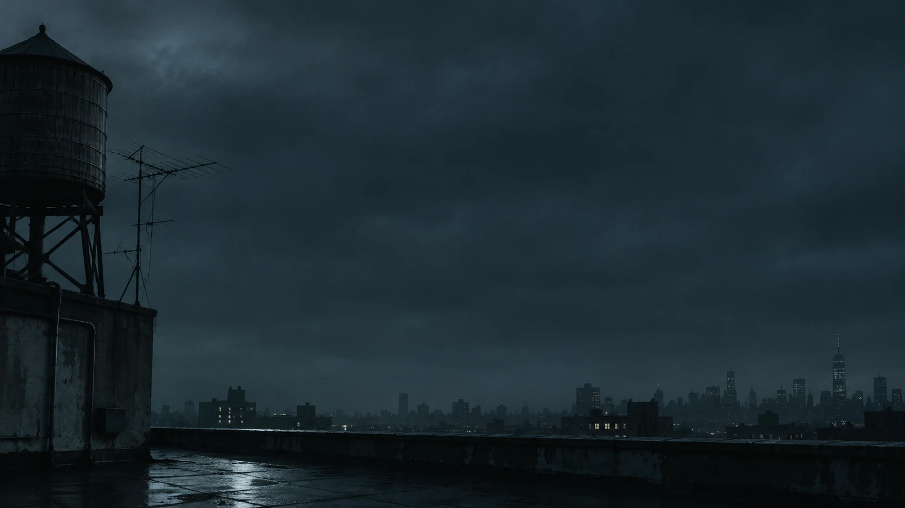
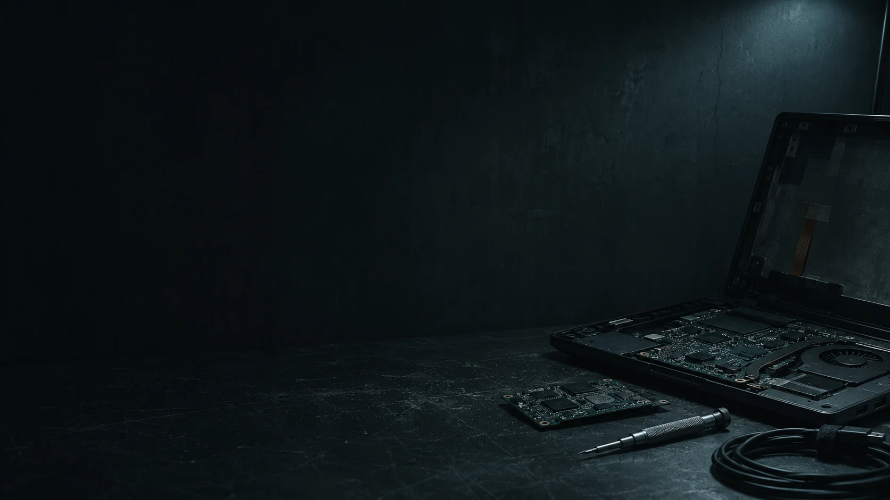

# Nightshift artwork

Generated with the built-in image-generation tool. These are original generated
scenes, not show stills. No generation or test code is stored in this repository.

## Additional cinematic wallpapers

Generated with the built-in image-generation tool. All five native outputs are
1672 × 941, preserved without resizing and encoded as WebP at quality 88.

### Last train

File: `backgrounds/10-last-train.webp`

Generation prompt:

Original cinematic photographic desktop wallpaper inspired by the quiet unsettling atmosphere of Mr. Robot. Landscape 16:9, request 3840x2160 if supported. Cold blue-black #050607 #0c0f11 palette, desaturated steel grey highlights, fine analog film grain, believable practical lighting, deep shadows with readable scene detail. Asymmetric composition and substantial calm dark negative space for desktop windows. No people, actors, show stills, readable text, logos, watermarks, HUD, fake computer UI, neon overload, frames or device mockups. Finished edge-to-edge wallpaper. Scene: An empty old New York subway car after midnight. View from the dark end of the carriage, worn blue-grey seats and brushed steel poles recede toward an off-center door at the far right. A single tired fluorescent light illuminates only the right third; the left half is deep shadow and dark window reflections. Claustrophobic, lonely, quietly realistic.

### Cold storage

File: `backgrounds/11-cold-storage.webp`

Generation prompt:

Original cinematic photographic desktop wallpaper inspired by the quiet unsettling atmosphere of Mr. Robot. Landscape 16:9, request 3840x2160 if supported. Cold blue-black #050607 #0c0f11 palette, desaturated steel grey highlights, fine analog film grain, believable practical lighting, deep shadows with readable scene detail. Asymmetric composition and substantial calm dark negative space for desktop windows. No people, actors, show stills, readable text, logos, watermarks, HUD, fake computer UI, neon overload, frames or device mockups. Finished edge-to-edge wallpaper. Scene: An aging corporate server room at night. Tall black server racks occupy the far left third and recede toward a small cold overhead light. Sparse tiny pale grey-green status LEDs, none bright or flashy. The center and right are dark concrete and shadow with broad clean negative space. Worn cabling and ventilation grilles, grounded industrial photography.

### End of line

File: `backgrounds/12-end-of-line.webp`

Generation prompt:

Original cinematic photographic desktop wallpaper inspired by the quiet unsettling atmosphere of Mr. Robot. Landscape 16:9, request 3840x2160 if supported. Cold blue-black #050607 #0c0f11 palette, desaturated steel grey highlights, fine analog film grain, believable practical lighting, deep shadows with readable scene detail. Asymmetric composition and substantial calm dark negative space for desktop windows. No people, actors, show stills, readable text, logos, watermarks, HUD, fake computer UI, neon overload, frames or device mockups. Finished edge-to-edge wallpaper. Scene: A shuttered seaside arcade long after closing. Three unbranded vintage arcade cabinets stand in silhouette at the far right, all screens switched off, faint cold light entering through a metal security shutter. Empty scuffed floor and dark painted wall extend across the left two thirds. A hint of salt-air haze, abandoned but not ruined, no readable signage.

### Above the noise

File: `backgrounds/13-above-the-noise.webp`

Generation prompt:

Original cinematic photographic desktop wallpaper inspired by the quiet unsettling atmosphere of Mr. Robot. Landscape 16:9, request 3840x2160 if supported. Cold blue-black #050607 #0c0f11 palette, desaturated steel grey highlights, fine analog film grain, believable practical lighting, deep shadows with readable scene detail. Asymmetric composition and substantial calm dark negative space for desktop windows. No people, actors, show stills, readable text, logos, watermarks, HUD, fake computer UI, neon overload, frames or device mockups. Finished edge-to-edge wallpaper. Scene: A lonely New York rooftop in predawn overcast darkness. A cylindrical wooden water tower and old antenna clustered on the far left, low distant skyline at the bottom. Vast dark blue-grey clouded sky across the center and right, subtle city haze, damp roof catching a narrow cold reflection. Severe negative space, architectural cinematic realism, no dramatic colorful sunrise.

### Open circuit

File: `backgrounds/14-open-circuit.webp`

Generation prompt:

Original cinematic photographic desktop wallpaper inspired by the quiet unsettling atmosphere of Mr. Robot. Landscape 16:9, request 3840x2160 if supported. Cold blue-black #050607 #0c0f11 palette, desaturated steel grey highlights, fine analog film grain, believable practical lighting, deep shadows with readable scene detail. Asymmetric composition and substantial calm dark negative space for desktop windows. No people, actors, show stills, readable text, logos, watermarks, HUD, fake computer UI, neon overload, frames or device mockups. Finished edge-to-edge wallpaper. Scene: Close cinematic view of an electronics repair bench in an unlit apartment. A dismantled black laptop, circuit board, precision screwdriver and neatly coiled cable occupy the bottom right quarter under a very dim cold task lamp outside the frame. Left and upper two thirds are dark matte work surface and wall. Tactile dust, brushed metal and worn plastic, no lit screen or readable labels.

## Wallpaper

File: `backgrounds/9-nightshift.webp`. Native output: 1672 × 941.
Converted to WebP at quality 88 without resizing; metadata omitted.

### Generation prompt

Use case: photorealistic-natural. Asset type: finished 16:9 desktop wallpaper, preferably 3840x2160. Create an original cinematic photograph evoking the quiet isolation of Mr. Robot: empty modest New York apartment at night, small aging black laptop on a worn desk at the far right lower third beneath a rain-streaked window. No people. The laptop has a dim blank cool-grey screen, no readable UI. Severe off-center composition: left two thirds are nearly black blue-grey plaster wall with barely visible natural texture, generous negative space for desktop windows. Rightmost window shows only soft out-of-focus city lights in desaturated steel blue. Cold blue-black palette #050607 #0c0f11 #161a1d, restrained grey highlights #5c686c. Moody but the laptop, desk edge and raindrops remain discernible. Fine subtle photographic grain, natural lens, grounded analog atmosphere. No text, logos, masks, HUD elements, fake terminal commands, neon, borders, bright central light, or watermarks. Edge-to-edge finished wallpaper, not a monitor mockup.

## Optional lock artwork

File: `unlock-nightshift.png`. Preserved at the generator's native dimensions.
Not automatically loaded; `unlock.png` remains the active default.

### Generation prompt

Use case: stylized-concept. Asset type: finished optional lock-screen graphic for a desktop theme; landscape 640:530 aspect ratio, ideally 1280x1060. Create a quiet cinematic photographic artwork: rain-streaked apartment window at night, confined to far right quarter; softly blurred distant city lights in desaturated steel grey, near-black blue-grey wall fills left and center. No people. Small silhouette of a closed laptop on a desk at bottom right, barely illuminated. Palette #050607 #0c0f11 #161a1d with muted #5c686c highlights. Near-black edges blend with dark shell. At lower left, discreet small precise monospaced text reads exactly 'hello, friend.' in muted light grey. This is the only text. Large empty dark central area; subtle film grain, restrained elegant composition, isolation and stillness inspired by Mr. Robot, original scene not a show still. No red decoration, logos, masks, HUD, fake password field, buttons, frames, watermarks, neon or bright highlights. Output only the finished artwork, no device mockup.

## Validation

Visually inspect both delivered files, including greeting spelling and dark
negative space. Validate image decoding and confirm only assets and Markdown
are added. These checks do not establish running Omarchy shell compatibility.

